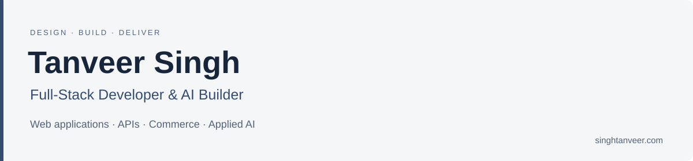

I build websites, web applications and useful AI tools. I’m a freelance full-stack developer based in Panjab, India, working across interfaces, backend logic, data and integrations.

I enjoy taking a workflow from the first screen through validation, backend rules and persistent data. My portfolio projects include working demos, documented trade-offs and tests.

### Stack & capabilities

My [portfolio toolkit](https://www.singhtanveer.com/about) covers the following areas. I choose the tools around the project’s requirements and existing systems.

| Area | Technologies & tools |
| --- | --- |
| Frontend | React, Next.js, TypeScript, JavaScript |
| Backend & APIs | Node.js, Express, PHP, Laravel, REST, GraphQL |
| Data & cloud | PostgreSQL, Redis, AWS |
| Commerce & content | Shopify, WordPress, WooCommerce, custom themes & plugins |
| Design & interaction | Figma, GSAP, responsive interfaces |

**Engineering practice:** system design, software engineering, testing & CI/CD, API integrations, performance optimization and debugging. See my [development and design services](https://www.singhtanveer.com/services) for how these fit into a project.

### Applied AI & continued learning

My current toolkit also includes **Python, C#, .NET, agentic AI, retrieval-augmented generation (RAG), generative AI and LLM applications**. I continue learning through hands-on work in these areas, focusing on document search, useful answers and workflow automation with clear checks and human review.

### Explore the projects

| Project | What you can try | Engineering focus |
| --- | --- | --- |
| [**WebhookLab**](https://github.com/tanveerchana/webhooklab) | Capture signed HTTP events, inspect payloads and replay failed deliveries. | Raw-body HMAC verification, bounded retries and event history. |
| [**FieldPilot**](https://github.com/tanveerchana/fieldpilot) | Take a renovation estimate through approval, a scheduled job and a paid invoice. | Validated state transitions, exact money calculations and review-first commands. |
| [**PayRoute Sandbox**](https://github.com/tanveerchana/payroute-sandbox) | Trigger provider failures, replay a payment key and reconcile a settlement statement. | Idempotency, deterministic routing and concurrent write safety. |

**Live demos:** [WebhookLab](https://webhooklab-umber.vercel.app) · [FieldPilot](https://fieldpilot-pied.vercel.app) · [PayRoute Sandbox](https://payroute-sandbox.vercel.app)

The demos use **React + TypeScript, Node serverless APIs and PostgreSQL**. Each repository documents its implementation stack, setup and access details. Payment providers and downstream delivery are simulated; no real funds move. FieldPilot uses a rule-based command preview with optional browser speech recognition.

### How I approach a build

- Understand the user’s workflow before choosing the implementation.
- Keep validation and business rules at the backend boundary.
- Test failure paths, duplicate requests and the numbers that matter.
- Make interfaces responsive, accessible and explicit about loading and errors.
- Document setup, architectural decisions and the limits of a demo.

### Work with me

[**Portfolio — singhtanveer.com**](https://singhtanveer.com) · [**LinkedIn**](https://www.linkedin.com/in/singhtanveerdev/)

Based in Panjab, India. Interested in practical web products, backend development and thoughtful user experiences.
